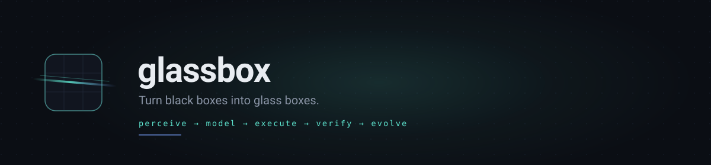
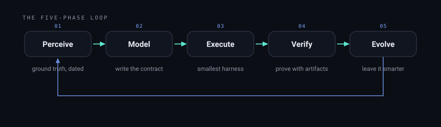

# glassbox

**Turn black boxes into glass boxes.**

Agent skills that teach any coding agent to reverse-engineer the systems you are
authorized to work with — methodically, with evidence at every step, and with
clear boundaries.

[](https://skills.sh/f2025408135-cyber/glassbox)
[](https://github.com/f2025408135-cyber/glassbox/actions/workflows/validate.yml)
[](LICENSE)



---

## The problem

Ask an agent to integrate a system it has never seen and watch what it produces:
paths, ports, statuses, response shapes — **from memory**. Confident. Plausible.
Sometimes right. You find out which one later, usually in production.

Real systems don't work like memory. Docs lag deploys. SDKs lag servers. The truth
lives in observed behavior — and reaching it takes method, not enthusiasm.

## Install

One command, any agent that supports the open Skills format:

```bash
npx skills add f2025408135-cyber/glassbox
```

Works with Claude Code, Codex, Cursor, opencode, Gemini CLI, Copilot, Windsurf,
Cline, Goose, Zed, Droid, Antigravity, and anything else that reads `SKILL.md`.

Prefer a manual install? Clone and run the installer. The manual installers
cover five common targets; `npx skills add` covers every harness.

```bash
git clone https://github.com/f2025408135-cyber/glassbox
cd glassbox

# macOS / Linux — or use --dir <path> alone for any custom skills directory
./install.sh claude                 # claude | opencode | codex | cursor | agents | all

# Windows
.\install.ps1 -Target claude
```

## Try it in 60 seconds

No agent required — watch the method run against a local mock API:

```bash
node examples/demo/run.mjs
```

The demo plays the whole loop end to end — captures exchanges, hits a
success-shaped failure, derives a contract, proves idempotency, and prints a
graded evidence log. Exit code 0 means every check passed.

## The twelve skills

| Skill | What it teaches | Load it when |
|---|---|---|
| [`deep-reverse-engineering`](skills/deep-reverse-engineering/SKILL.md) | The full loop: scope, perceive, model, execute, verify, evolve | A multi-phase engagement where no specialist fits |
| [`recon`](skills/recon/SKILL.md) | Ground truth: truth hierarchy, surfaces, protection classes, limits | Docs and behavior disagree; first contact |
| [`protocol-cartography`](skills/protocol-cartography/SKILL.md) | Contracts from captures: streams, error censuses, dialects | Decoding any API, stream, or wire format |
| [`flow-modeling`](skills/flow-modeling/SKILL.md) | State machines, leases, retries, idempotency, capacity | Multi-step flows and hidden limits |
| [`credential-hygiene`](skills/credential-hygiene/SKILL.md) | Credential classes, refresh, pools, secret hygiene | Sessions, tokens, and keys are involved |
| [`evidence-protocol`](skills/evidence-protocol/SKILL.md) | The gate function, falsification, airtight probes | Before any "it works" claim |
| [`adversarial-review`](skills/adversarial-review/SKILL.md) | Review lenses, bounded fix loops, publication checks | Before anything ships |
| [`durable-goals`](skills/durable-goals/SKILL.md) | State outside context, watchdogs, budgets, resume | Work that spans sessions or must survive restarts |
| [`swarm-orchestration`](skills/swarm-orchestration/SKILL.md) | Probe, cap, wave, verify, integrate | Parallel workers and fanout |
| [`quality-loops`](skills/quality-loops/SKILL.md) | Evaluator-optimizer, rubrics, review gates | Iterating to a quality bar |
| [`self-evolving-skills`](skills/self-evolving-skills/SKILL.md) | The memory triad: lessons, state, run log | Making a workflow learn from runs |
| [`honest-fences`](skills/honest-fences/SKILL.md) | Scope, approval gates, defensive posture, publication | Anything touching access or publication |

## The loop



`Perceive → Model → Execute → Verify → Evolve`

- **Perceive** — live behavior outranks every document; tag every fact with its
  source and date.
- **Model** — write the contract and the state machine down; files outlive
  sessions.
- **Execute** — build the smallest harness that works, with gates that actually
  gate.
- **Verify** — no claim without an artifact; run the command, read the output,
  then speak.
- **Evolve** — consult the lessons before the run, append what changed after it.

## How it works in practice

A composite example, sanitized from the field notes (the full set is in
[`docs/field-notes/`](docs/field-notes/)):

```text
> Integrate api.example.com so we can submit jobs and poll results.

1. Scope written. Basis: our own account; read+write to two documented paths.
2. Protection classified: silent (throttle windows, no human step).
3. Handshake captured. Pagination cursor found — opaque, must be echoed exactly.
4. Error census built: failures arrive as HTTP 200 with a failure payload.
   Branch on the payload. (This alone killed three "mystery" retries.)
5. Contract written and replayed from a clean state. Second replay: no duplicates.
6. Evidence log: submit → poll → fetch result, terminal state reached twice.

Exit: model predicts the next response before the call; no claim unbacked.
```

That is the whole product: a confident agent becomes a *methodical* one.

## Who it is for

- **Integration and platform engineers** holding someone else’s API.
- **SREs and maintainers** staring at legacy behavior nobody documented.
- **Authorized security researchers and red teams** who want their rigor
  packaged, not improvised.
- **Data and network engineers** decoding streams and dialects.
- **Agents themselves** — the skills trigger automatically once installed.

## Straight answers

- **Is this a toolkit for defeating protections?** No. It ships nothing whose
  value is defeating a protection system: interactive human-verification steps
  are routed to humans, defensive systems are left alone, and publication passes
  an abstraction review. Read the [ethics charter](docs/ETHICS.md).
- **Is it just markdown prompts?** The skills are instructions, but the repo
  ships a runnable demo (`node examples/demo/run.mjs`), a validator
  (`node tools/validate.mjs`), installers, and a worked example — verify claims
  instead of trusting them.
- **Where do the field notes come from?** Composite case studies drawn from
  sanitized field work; each one is rewritten until no system, person, or value
  survives. They teach the method, not a war story.
- **Why twelve skills and not one document?** Progressive disclosure: agents
  load the one manual that matches the situation, so context is spent on the
  work, not on reading everything.

## Principles

- The wire is the truth. Observed behavior outranks docs, SDKs, and memory.
- A model is a thing you write down; context windows die, files don’t.
- No claim without an artifact — commands and outputs, not confidence.
- Failure is a first-class outcome; “blocked with evidence” beats “kept trying”.
- Boundaries are part of the method: authorized scope, approval gates, honest
  classification of protection surfaces, and stopping when a system defends
  itself.

Read the full [manifesto](docs/MANIFESTO.md).

## Ethics — read this first

Glassbox is built for systems you own or are explicitly authorized to work
with. The boundary is not a constraint on the method — the boundary is the
method. Start with the [ethics charter](docs/ETHICS.md) and the
[`honest-fences`](skills/honest-fences/SKILL.md) skill.

## Repository map

```text
skills/            the twelve skills (SKILL.md + references/)
docs/              manifesto, ethics charter, patterns, FAQ, field notes
examples/demo/     the 60-second runnable demo
examples/          a worked recon workspace (fictional target)
tools/             validate.mjs — the repo’s own validator
install.sh/.ps1    manual installers
AGENTS.md          drop-in doctrine for agents working in this repo
```

## Documentation

- [Manifesto](docs/MANIFESTO.md) — why this exists.
- [Ethics charter](docs/ETHICS.md) — the boundary rules.
- [Pattern library](docs/PATTERNS.md) — 60+ named techniques, indexed.
- [Field notes](docs/field-notes/) — sanitized case studies.
- [FAQ](docs/FAQ.md) — what, why, and how to extend.

## Contributing

Skills are code: review them like code. Read
[CONTRIBUTING.md](CONTRIBUTING.md) — the authoring contract, the review
process, and what this project will never accept. Run `node tools/validate.mjs`
before opening a PR.

## License

[MIT](LICENSE). Use them, fork them, ship them inside your team, improve them
and send the improvements back.